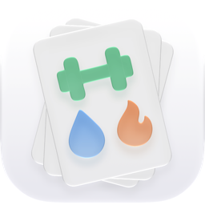
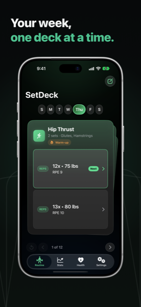
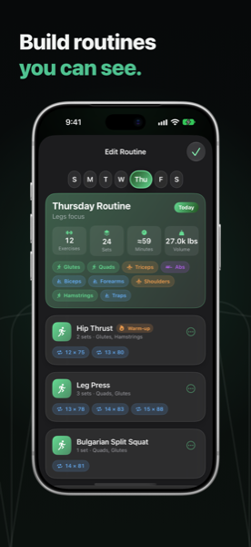
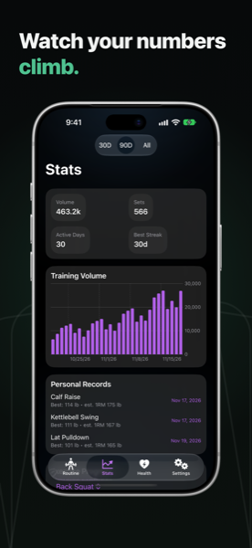
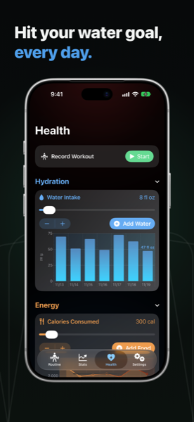

<p align="center">
  
</p>

<h1 align="center">SetDeck</h1>

<p align="center"><strong>Plan the training week, log every set, and watch the numbers climb.</strong></p>

<p align="center">
  <a href="https://apps.apple.com/us/app/setdeck/id6484503374">App Store</a> &middot;
  <a href="https://farsidesoftware.com/setdeck">Product page</a> &middot;
  <a href="https://farsidesoftware.com/support">Support</a>
</p>

<p align="center">
  
  
  
  
</p>

SetDeck is a strength training tracker built around the way lifters train: a routine for each day of the week, the exercises in it, and the sets inside each exercise. It syncs privately through iCloud and works with Apple Watch, Siri, and Apple Health. This repository is the current codebase, which is SetDeck 3.0.

## What it does

- **Plan your week.** A routine for each day, shown as a deck of exercise cards with muscle-group colors. Four set types: reps, AMAP, timed duration, and freeform, with warm-ups and targets for weight, reps, and time.
- **Log in a tap.** Mark sets complete, rate effort with RPE, and switch between pounds and kilograms. Every completed set is saved to your history.
- **See what is working.** Training volume over time, a muscle heatmap, muscle distribution, intensity charts, personal records with estimated one-rep max, and 19 achievements.
- **Apple Health.** Record strength training workouts, follow them in a Live Activity on the Lock Screen and Dynamic Island, and log water and calories with widgets and a Control Center control. Optional water reminders have a daily goal.
- **Apple Watch.** Today's routine, set logging, a guided rest timer, workout start and stop, and a complication.
- **Siri, Shortcuts, and Spotlight.** Ask for today's workout, start and stop a workout, add water or calories, and find exercises in Spotlight.
- **iPhone Duo.** Unfolded, the routine deck sits beside your week, stats become two columns, and Settings splits into a list and detail pane.

Every feature is free, with no accounts and no ads. SetDeck is available in English, Spanish, Canadian French, and Japanese.

## Platforms and requirements

- iPhone and iPad (iOS 18 or later) and Apple Watch (watchOS 11 or later).
- To build: Xcode 27, Swift 6 language mode, and an Apple Developer account for the CloudKit and HealthKit capabilities.

## Building

1. Clone the repository and open `SetDeck.xcworkspace`, not the bare `.xcodeproj`. It resolves the local package in `Packages/SetDeck`.
2. Set your signing team and update the bundle identifiers and the App Group and iCloud container identifiers.
3. Enable the capabilities: iCloud (CloudKit, private database), HealthKit with background delivery, App Groups (shared with the widgets and watch app), and Siri.
4. Build and run the `SetDeck` scheme.

Run the package tests, which need no simulator:

```sh
cd Packages/SetDeck && swift test
```

## Architecture

SetDeck is a thin app target on top of an SPM umbrella package of layered modules. Dependencies point inward: features depend on the design system and core, data implements core's protocols, and core depends on nothing.

```
SetDeck app / widgets / watch (thin shells)
    └── SetDeckComposition       SessionController (composition root) + RootView/MainView
            ├── SetDeckFeature*  Routine · Stats · Health · Settings · Onboarding
            ├── SetDeckFeatureShared  WorkoutDataModel · AchievementModel
            ├── SetDeckServices  HealthKit and Live Activities · CloudKit sync · WatchConnectivity · on-device ML
            ├── SetDeckData      SwiftData repositories · CloudKit store with graceful fallback
            ├── SetDeckDesignSystem  brand colors and tokens · glass styles
            └── SetDeckCore      models · domain logic · protocols · watch wire DTOs (pure)
```

- **Repositories and use-cases.** Views never touch SwiftData. Every read and write goes through a single-verb use-case with typed errors.
- **One change stream.** Repositories and CloudKit imports notify a single `AsyncStream` that screens, achievements, and Spotlight all observe.
- **Graceful persistence.** CloudKit, then local-only, then in-memory, so a storage problem never crashes the launch.

`CLAUDE.md` has the module-by-module detail.

## Privacy

Your routines and history stay in your private iCloud container. Health data is read and written only with your permission, muscle-group suggestions run on-device, and there is no analytics or tracking.

---

Made by [Farside Software LLC](https://farsidesoftware.com). Released under the MIT License, see [LICENSE](LICENSE).
